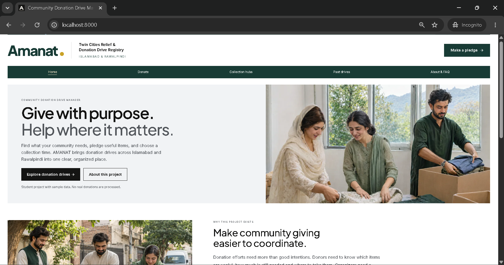
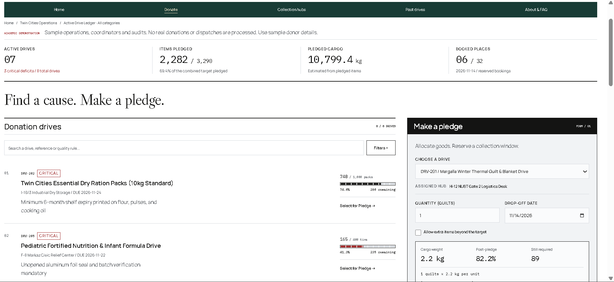
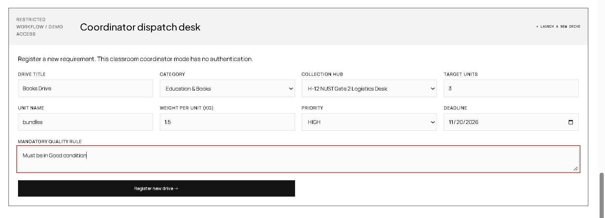
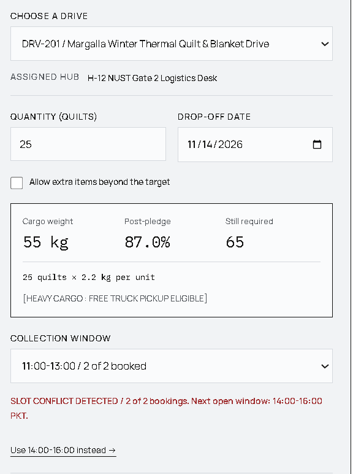
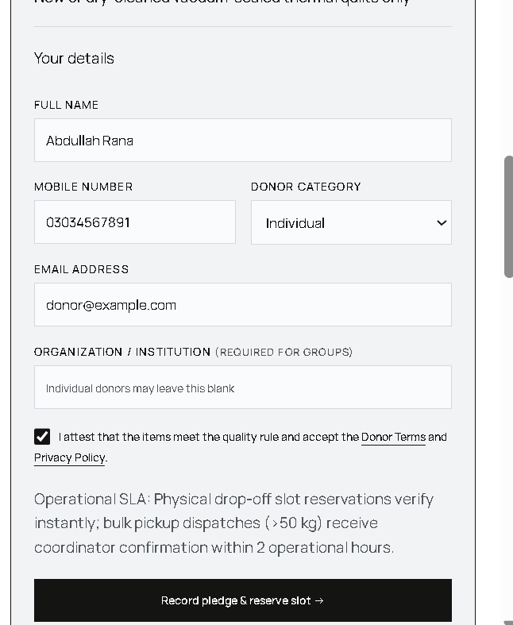
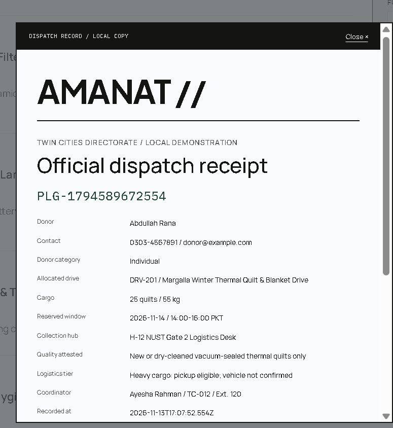
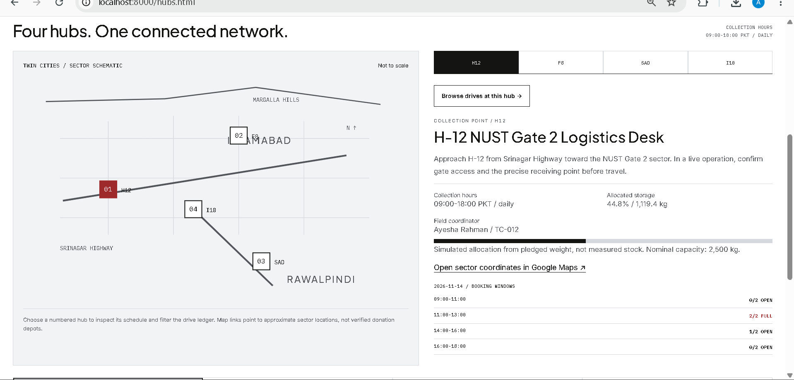
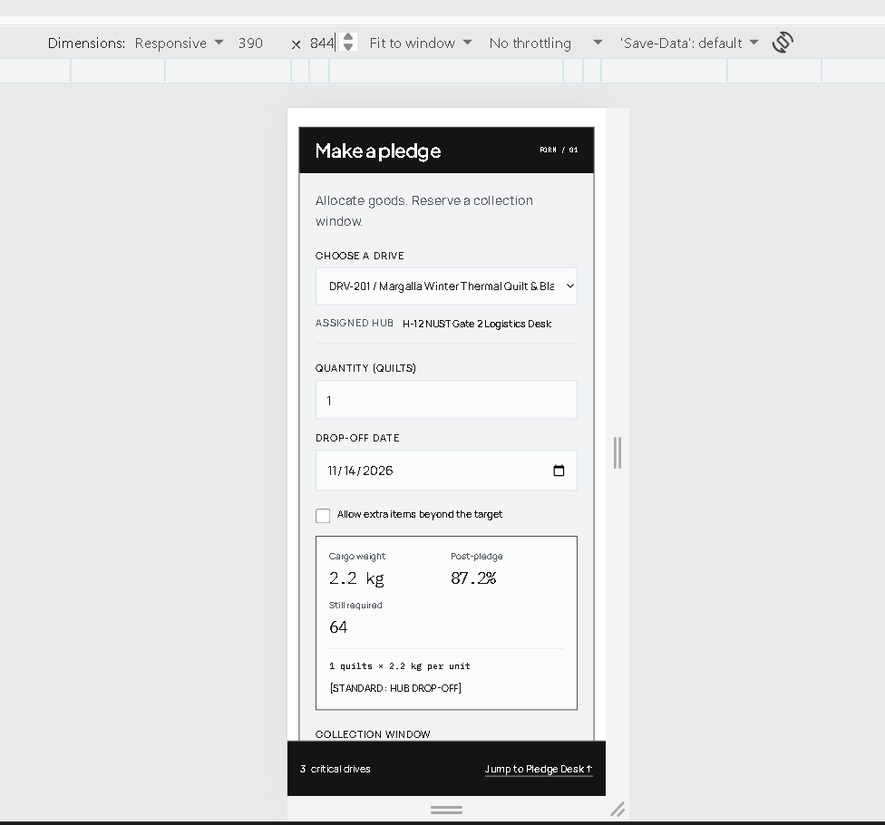

# AMANAT — Community Donation Drive Manager

A client-side CS344 Web Engineering project for Assignment 1, Topic 20. AMANAT demonstrates how donors can find community requirements, pledge items and reserve collection windows across Islamabad and Rawalpindi.

**Student:** Muhammad Abdullah Rana  
**Assigned idea:** Topic 20, Community Donation Drive Manager.  
**Rule:** Each collection hub accepts at most two bookings per date and time window. A full window blocks another pledge and suggests a later available window when possible. Cargo of 50 kg or more is eligible for a simulated pickup request.

This educational simulation manages commitments and bookings, not payments, actual deliveries or verified charity operations.

## Start the application

Prerequisites: Node.js and a modern browser such as Chrome or Edge. Download/extract the repository, or clone it with:

```powershell
git clone https://github.com/AbdullahRana11/Donation-Drive-Manager.git
cd Donation-Drive-Manager
```

From the project folder, run:

```text
node scripts/serve.cjs
```

Open **http://localhost:8000**. Stop the preview with Ctrl+C. No package installation or build step is needed. The helper serves the HTML pages and public `css/`, `js/` and `assets/` folders, and returns the custom 404 page for unknown routes. Documentation and reference material are not exposed.

You can also open `index.html` directly. A local HTTP address is recommended because file-URL storage policies vary between browsers. Keep using the same origin: `localhost` and `127.0.0.1` have separate local storage.

## Project structure

```text
Assignment 1/
|-- index.html                  Home and project introduction
|-- drives.html                 Donation desk and coordinator tools
|-- hubs.html                   Collection map and receiving schedules
|-- reports.html                Past-drive scenarios and sample audits
|-- about.html                  Project scope, FAQ and team
|-- thank-you.html              Latest saved receipt
|-- legal.html                  Donor terms and privacy policy
|-- 404.html                    Recovery route directory
|-- robots.txt
|-- sitemap.xml
|-- css/
|   |-- styles.css              Shared layout, colors and base rules
|   |-- responsive.css          Fluid widths and device-specific layout refinements
|   |-- fonts.css               Shared local font definitions
|   |-- header.css              Shared header styling
|   |-- photography.css         Home and About image layouts
|   |-- drives-typography.css   Donation-page font roles and text styling
|   `-- drives-fonts.css        Donation-page local font definitions
|-- js/
|   `-- app.js                  Data, DOM rendering and application logic
|-- assets/
|   |-- images/                 SVG artwork and local community imagery
|   `-- fonts/
|       |-- *.ttf               Local font files
|       `-- licenses/           Copyright and font license notices
|-- docs/
|   |-- PROJECT-BRIEF.md        Requirements, records and validation rules
|   |-- DESIGN-NOTE.md          User/problem, WDLC and client/server boundary
|   |-- WIREFRAME.md            Layout sketches and page map
|   |-- ATTRIBUTION.md          Asset origins and AI assistance
|   |-- VERIFICATION.md         Browser and workflow checks
|   `-- screenshots/            Eight current submission screenshots
|-- scripts/
|   `-- serve.cjs               Optional local static preview helper
|-- .gitignore                  Local report/reference/temp exclusions
`-- README.md                   Setup and project guide
```

HTML entry points stay at the project root. This keeps page URLs stable and makes the home page easy to open. Styles, scripts, assets and supporting documents each have a dedicated location.

## Screenshots

These captures were supplied by the project owner from the running application in November 2026. Dates and quantities depend on the current browser records. The coordinator example creates a Books Drive; the pledge examples use the seeded DRV-201 quilt drive.

### 1. Home page

Project introduction, navigation and donation entry points.



### 2. Donation dashboard

Summary statistics, drive requirements, search and the pledge desk.



### 3. Create a drive

The coordinator form populated for a Books Drive with a target of three bundles.



### 4. Booking conflict and live calculation

For DRV-201, 25 quilts weigh 55 kg and would raise completion to 87.0%, leaving 65 units. The 11:00–13:00 window already has two bookings, so the application suggests 14:00–16:00.



### 5. Donor details and quality confirmation

The donor-entry stage before submission. Phone input must satisfy the required `03XX-XXXXXXX` format before the pledge can be saved.



### 6. Saved pledge receipt

Receipt for 25 quilts, 55 kg and the available 14:00–16:00 window. References are generated when records are saved.



### 7. Collection hubs

The H-12 hub, sector schematic and receiving-window occupancy after the pledge.



### 8. Mobile layout

The donation form in Chrome's responsive preview at a 390 × 844 viewport. This is browser emulation, not a physical-device test.



## Demonstrate the core workflow

1. Open the local site in a fresh Incognito/InPrivate session and keep it open. Open Donate to initialize eight sample drives and six bookings. Opening totals are 2,282 of 3,290 units and 10,799.4 kg. The bookings are already included in those totals. There is no reset button in the current interface.
2. Open Filters to combine category, hub, urgency, fulfilled status and search. Search `BPA-free` to match an acceptance rule. Try the four sort orders.
3. Expand Coordinator dispatch desk. Create `Demo Winter Quilt Drive`: Apparel & Bedding, H-12 NUST Gate 2 Logistics Desk, target `500`, unit `quilts`, weight `2.20`, priority `HIGH`, deadline 14 days from today, and quality rule `Clean, dry quilts, packed individually without tears.` This future-dated drive keeps the demonstration usable after seed deadlines expire.
4. Select the new drive. Enter quantity `25`, choose tomorrow's Pakistan date and `11:00–13:00`. The two initial H-12 bookings make that window full; accept the suggested `14:00–16:00` window. This new empty drive's preview shows `55 kg`, `5%` completion and `475` remaining, unlike the seeded DRV-201 screenshot above.
5. Enter fictional details such as `Demo Donor`, `0300-1234567` and `demo.donor@example.com`. Choose Individual, leave Organization blank and surplus off, attest to the quality rule and record the pledge.
6. Print the receipt or open the latest receipt page. Reload Donate to confirm persistence, then revoke the booking to release its units and reservation. The new drive returns to zero pledged units.
7. Export the drive manifest as CSV. The first new drive reference is normally DRV-209 in a fresh session.
8. Visit Collection hubs, choose a hub, and follow its link to the filtered donation page.

## Implementation

The application uses semantic HTML, CSS and vanilla JavaScript. There is no frontend framework, build system, PHP or database. `js/app.js` contains the seed records, filters, calculations, validation, booking creation/revocation, new-drive workflow, CSV generation, receipts and local telemetry.

Plus Jakarta Sans is used for the wordmark and most display headings. Manrope and Inter provide interface text, while IBM Plex Mono distinguishes quantities and references. The donation-page headline uses Libre Caslon Display. Fonts, images and SVG artwork are local, so the running application needs no internet connection. Google Maps opens externally only when a directions link is selected.

The review covered the supplied lectures except the PHP and database lectures. See the [design note](docs/DESIGN-NOTE.md) for the seven WDLC stages and lecture concepts, the [wireframe](docs/WIREFRAME.md) for the layout, and the [project brief](docs/PROJECT-BRIEF.md) for the data and validation rules.

## Data and limitations

- Browser keys: `amanat_drives_v1`, `amanat_pledges_v1`, `amanat_latest_receipt_v1` and `amanat_telemetry_v1`. Moving the source files does not change these keys. Data stays in the browser profile and origin.
- Each hub/date/window accepts two bookings. Cargo at or above 50 kg is pickup-eligible in the simulation. No real vehicle, payment or collection is arranged.
- Seed deadlines retain the exact November/December 2026 dates from the brief. After they pass, create a new drive with a future deadline for a submission demonstration.
- Clearing this site's browser data removes saved drives, pledges and receipts; reopening Donate initializes sample records. Revocation removes the live booking; its latest receipt snapshot remains marked inactive until replaced or cleared. Printed/downloaded copies are separate.
- A storage listener refreshes records from another tab. Simultaneous edits are not atomic; this is a single-browser prototype, without shared server bookings or authentication.
- Use sample donor details. Anyone using the browser profile can view its records. All staff, inspection sign-offs and historical outcomes are fictional. Hub coordinates are approximate sector references, not verified receiving depots.
- The deployment address is `https://abdullahrana11.github.io/Donation-Drive-Manager/`. The sitemap lists the six public content pages at that address, excluding the browser-specific receipt and error page. The project-level `robots.txt` contains the sitemap URL; crawlers normally read robots rules from the domain root, so this subdirectory file does not control the whole GitHub Pages domain. GitHub Pages must be enabled separately from pushing source code. The local execution instructions above also support a classroom demonstration.

## Verification

[VERIFICATION.md](docs/VERIFICATION.md) records the browser checks for filtering, booking conflicts, validation, pledge persistence, receipts, revocation, coordinator creation, CSV, accessibility behavior and responsive layouts. The folder reorganization was checked for broken links, missing fonts/assets, page navigation and the core pledge workflow.

## Academic integrity and AI disclosure

The supplied assignment brief prohibits generated full-site code and requires disclosure of AI assistance. OpenAI Codex was used extensively for requirements organization, HTML, CSS, JavaScript, copy, original SVGs, font integration, documentation and verification. AI produced most implementation drafts and subsequent revisions under the project owner's direction. The owner supplied requirements, directed changes and provided the screenshots above. No measured percentage of AI-written code is available, so no exact percentage is claimed.

This disclosure describes the actual assistance; it does not claim independently handwritten implementation or instructor approval. The [attribution document](docs/ATTRIBUTION.md) lists asset origins and local font licenses. The instructor's original document and the separate Word report stay outside the repository.

## Responsive layout

All eight pages use shared fluid gutters and `css/responsive.css`. Desktop content uses the available width; tablet and phone layouts stack grids, keep all navigation links visible, provide labeled table records and resize controls. Small-screen text inputs use 16px text, and receipt dialogs scroll within the available viewport. The red slashes beside the Amanat wordmark have been removed.

Checks covered 15 viewport widths from 280px through 2560px across all pages, a 640px reflow view equivalent to a 1280px window at 200% zoom, and the mobile pledge workflow. Chrome and Edge were also checked after the small-screen header refinement. Physical devices and Safari/Firefox have not been tested.

The three Pakistani community images were generated with OpenAI's image-generation tool and depict fictional people and settings. They are stored in `assets/images/generated/` as original PNGs and responsive WebP variants. Styling is in `css/photography.css`; the [attribution document](docs/ATTRIBUTION.md) records their provenance. All variants are local for offline use.
